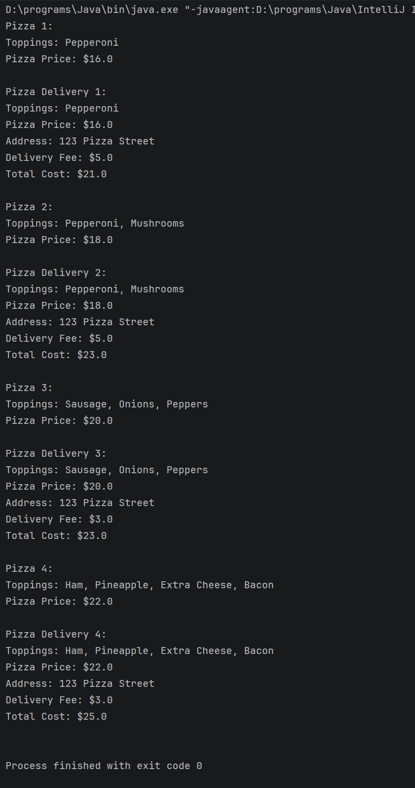

# Pizza and Delivery Pizza

## Description

This Java program demonstrates the use of classes, inheritance, arrays, constructors, and methods.

The program contains a `Pizza` class that stores up to 10 pizza toppings, calculates the price of the pizza, and creates a description of the selected toppings.

The `DeliveryPizza` class inherits from the `Pizza` class and adds a delivery address and delivery fee. The delivery fee is determined by the price of the pizza.

The program tests pizzas with different numbers of toppings to demonstrate how the pizza price and delivery fee change.

## Running the Program

1. Open the project in IntelliJ IDEA.
2. Open `Main.java`.
3. Run the `main()` method.
4. The pizza and delivery information will be displayed in the console.

## Program Output

 